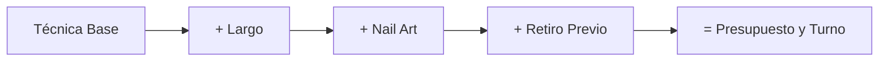
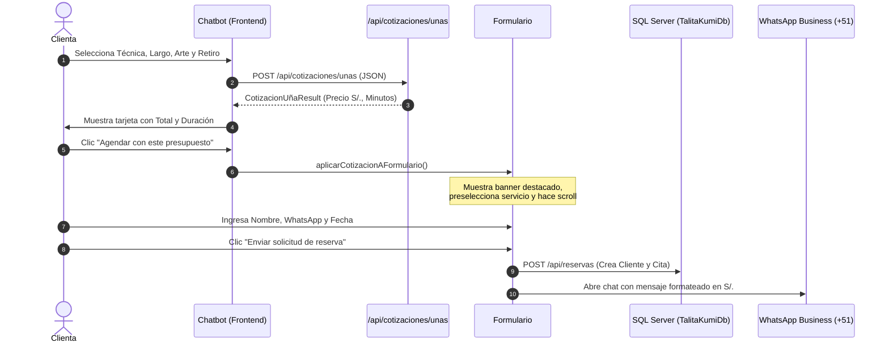

# 💅 Manejo de Precios y Cotizaciones · Talita Kumi

Este documento describe la arquitectura, reglas de negocio, matriz tarifaria y flujo de integración del sistema de precios y cotizaciones implementado en **Talita Kumi - Estudio de Belleza**.

---

## 1. Principios Generales
* **Moneda Oficial:** Todos los precios del sistema están expresados exclusivamente en **Soles Peruanos (`S/.`)**.
* **Enfoque Dual de UX:**
  1. **Servicios Fijos / Directos:** Servicios tradicionales de precio y duración estándar (Pedicura, Lifting, Depilación) que se pueden reservar directamente desde la web.
  2. **Servicios Dinámicos / Personalizados (Uñas):** Servicios cuyo costo y tiempo varían drásticamente según la técnica, largo, arte y retiro previo. Cuentan con un **Chatbot Asistente** que cotiza en tiempo real antes de agendar.
* **Persistencia:** Todo precio pactado y tiempo calculado queda registrado en la base de datos SQL Server (`TalitaKumiDb`) y se envía formateado a WhatsApp para evitar malentendidos entre clienta y especialista.

---

## 2. Catálogo de Servicios Base

La base de datos (`Servicios`) y la landing page cuentan con un catálogo estándar con precios base referenciales para Tarapoto, Perú:

| ID | Categoría | Servicio | Precio Base (`S/.`) | Duración Estimada | Personalizable con Bot |
|:---:|:---|:---|:---:|:---:|:---:|
| 1 | Uñas | Manicura Semipermanente / Rusa | `S/. 45.00` | 60 min (1h) | ✅ Sí |
| 2 | Uñas | Kapping Gel / Fortalecimiento | `S/. 65.00` | 75 min (1h 15m) | ✅ Sí |
| 3 | Uñas | Soft Gel Tips / Extensiones | `S/. 90.00` | 90 min (1h 30m) | ✅ Sí |
| 4 | Uñas | Uñas Esculpidas en Acrílico | `S/. 120.00` | 120 min (2h) | ✅ Sí |
| 5 | Pedicura | Pedicura Spa & Rusa | `S/. 45.00` | 45 min | ❌ No (Fijo) |
| 6 | Pedicura | Pedicura Completa + Semipermanente | `S/. 65.00` | 60 min (1h) | ❌ No (Fijo) |
| 7 | Mirada | Lifting + Tinte de Pestañas | `S/. 70.00` | 60 min (1h) | ❌ No (Fijo) |
| 8 | Mirada | Laminado & Perfilado de Cejas | `S/. 55.00` | 45 min | ❌ No (Fijo) |
| 9 | Mirada | Combo Mirada Completa (Lifting + Laminado) | `S/. 110.00` | 90 min (1h 30m) | ❌ No (Fijo) |
| 10 | Otros | Depilación Facial con Cera (Bozo/Cejas) | `S/. 25.00` | 20 min | ❌ No (Fijo) |
| 11 | Otros | Retiro de Sistema Anterior (Solo retiro) | `S/. 20.00` | 30 min | ❌ No (Fijo) |

---

## 3. Motor de Cotización de Uñas (`NailPricingEngine`)

El motor ubicado en [`Services/NailPricingEngine.cs`](file:///Volumes/Mac_Env/TalitaKumi/TalitaKumiWebApp/Services/NailPricingEngine.cs) opera bajo una **fórmula acumulativa aditiva** tanto para el precio en Soles como para la duración en minutos de atención:

$$\text{Precio Total} = \text{Base (Técnica)} + \Delta\text{Largo} + \Delta\text{Nail Art} + \Delta\text{Retiro}$$
$$\text{Duración Total} = \text{Minutos Base} + \Delta\text{Minutos Largo} + \Delta\text{Minutos Arte} + \Delta\text{Minutos Retiro}$$

### Matriz de Variantes y Tarifas

#### Paso 1: Técnica Base
Define la estructura y resistencia de las uñas:
* **Semipermanente:** `S/. 45.00` · 60 minutos (Manicura combinada con esmaltado semipermanente).
* **Kapping Gel:** `S/. 65.00` · 75 minutos (Baño de gel o acrigel para reforzar uña natural).
* **Soft Gel Tips:** `S/. 90.00` · 90 minutos (Tips completos de gel preformados y adheridos con base gel).
* **Uñas Esculpidas:** `S/. 120.00` · 120 minutos (Construcción con molde y acrílico profesional).

#### Paso 2: Largo Deseado
* **Natural / Corto (N° 0):** `+S/. 0.00` · `+0 min`.
* **Largo Medio (N° 1 a 2):** `+S/. 15.00` · `+15 min`.
* **Largo XL / Extremo (N° 3 a 5):** `+S/. 30.00` · `+30 min`.

#### Paso 3: Diseño y Nail Art
* **Color Liso / Básico:** `+S/. 0.00` · `+0 min` (1 o 2 tonos de esmalte plano).
* **Francesita / Cat Eye / 2 Uñas Decoradas:** `+S/. 15.00` · `+20 min` (French clásico o degradé, efecto ojo de gato magnético o detalle sutil).
* **Full Nail Art / 3D / Cristales:** `+S/. 35.00` · `+40 min` (Mano alzada en todas las uñas, relieve 3D, pedrería o encapsulados).

#### Paso 4: Retiro de Material Previo
* **Sin Retiro (Uñas limpias):** `+S/. 0.00` · `+0 min`.
* **Retiro de Semipermanente anterior:** `+S/. 10.00` · `+20 min`.
* **Retiro de Acrílico o Soft Gel externo:** `+S/. 20.00` · `+30 min`.

---

## 4. Ejemplos Prácticos de Cotización



### Ejemplo A: Manicura Express Clásica
* **Técnica:** Semipermanente (`S/. 45.00` / 60m)
* **Largo:** Natural (`+S/. 0.00` / 0m)
* **Arte:** Liso (`+S/. 0.00` / 0m)
* **Retiro:** Ninguno (`+S/. 0.00` / 0m)
* **Resultado:** **`S/. 45.00`** · **1 hora**

### Ejemplo B: Soft Gel con Francesita (Caso más popular)
* **Técnica:** Soft Gel (`S/. 90.00` / 90m)
* **Largo:** Medio (`+S/. 15.00` / 15m)
* **Arte:** Francesita / French (`+S/. 15.00` / 20m)
* **Retiro:** Ninguno (`+S/. 0.00` / 0m)
* **Resultado:** **`S/. 120.00`** · **2h 05m (125 minutos)**

### Ejemplo C: Esculpidas XL con Full Nail Art y Retiro
* **Técnica:** Esculpidas (`S/. 120.00` / 120m)
* **Largo:** Extremo XL (`+S/. 30.00` / 30m)
* **Arte:** Full Nail Art 3D (`+S/. 35.00` / 40m)
* **Retiro:** Retiro de acrílico previo (`+S/. 20.00` / 30m)
* **Resultado:** **`S/. 205.00`** · **3h 40m (220 minutos)**

---

## 5. Arquitectura del Flujo y Puntos de Integración



### 1. Chatbot Asistente (`wwwroot/js/chatbot.js`)
* Widget flotante accesible desde cualquier página.
* Llama al endpoint `POST /api/cotizaciones/unas`. Si no hubiera conexión de red temporal, cuenta con un motor de cálculo *fallback* idéntico en JavaScript para no interrumpir a la clienta.
* Al presionar **"Agendar con este presupuesto"**, llama a la función global `window.aplicarCotizacionAFormulario(cotizacion)`.

### 2. Formulario Web (`Views/Home/Index.cshtml` & `wwwroot/js/site.js`)
* **Banner de Cotización Activa (`#cotizacionBanner`):**
  Aparece en la parte superior del formulario indicando el total en `S/.`, el tiempo estimado y el detalle. Permite quitar la cotización con una "X" si la clienta prefiere un servicio estándar.
* **Sugerencia Inteligente (`#nailHelperAlert`):**
  Si una clienta va directamente al selector manual y elige un servicio de uñas (ej. *Soft Gel*), aparece un mensaje discreto:
  > *"💡 ¿Deseas personalizar largo o nail art? Cotiza tu diseño exacto en 30s con el Asistente →"*

### 3. Registro en SQL Server (`Data/AppDbContext.cs`)
Al enviarse el formulario:
1. Se verifica si el número de WhatsApp ya pertenece a un cliente en la tabla `Clientes`. Si no existe, se crea automáticamente.
2. Se asocia la cita en `Reservas` con su `ClienteId`, `ServicioId`, `PrecioEstimado` y `DuracionMinutos`.
3. Si vino del chatbot, se guarda la fila en `CotizacionesUñas` con los subtotales para auditoría del salón.

### 4. Mensaje a WhatsApp (+51 911 345 678)
La aplicación genera una URL codificada para WhatsApp web o móvil con este formato:

```text
¡Hola Talita Kumi! Deseo solicitar una reserva:

🌸 Nombre: Valeria Gomez
📱 WhatsApp: 987112233
💅 Servicio: Soft Gel (Largo Medio, Arte Francesita)
💰 Precio Estimado: S/. 120.00
⏱️ Duración aprox.: 125 min
📅 Fecha: 2026-10-25
⏰ Horario: Tarde temprano (13:00 a 16:30)
📝 Nota adicional: Tengo una uña fisurada
✨ Personalización: Soft Gel Tips: S/. 90.00, Largo Medio: +S/. 15.00, Diseño French: +S/. 15.00
```

---

## 6. Dónde Modificar Tarifas en el Futuro

Si el salón decide cambiar precios o añadir nuevas técnicas:

1. **Tarifas del Motor de Cotizaciones:**
   Modificar los diccionarios de precios y minutos en [`Services/NailPricingEngine.cs`](file:///Volumes/Mac_Env/TalitaKumi/TalitaKumiWebApp/Services/NailPricingEngine.cs):
   * `PreciosBaseTecnica` y `MinutosBaseTecnica`.
   * `PreciosLargo` y `MinutosLargo`.
   * `PreciosNailArt` y `MinutosNailArt`.
   * `PreciosRetiro` y `MinutosRetiro`.
2. **Textos y Badges del Chatbot:**
   Actualizar los badges informativos en [`wwwroot/js/chatbot.js`](file:///Volumes/Mac_Env/TalitaKumi/TalitaKumiWebApp/wwwroot/js/chatbot.js) (array `steps`).
3. **Catálogo de Base de Datos y Formulario:**
   * Actualizar el seed de [`Data/AppDbContext.cs`](file:///Volumes/Mac_Env/TalitaKumi/TalitaKumiWebApp/Data/AppDbContext.cs) (método `OnModelCreating`).
   * Actualizar los atributos `data-base-price` y `data-duration` en los `<option>` de [`Views/Home/Index.cshtml`](file:///Volumes/Mac_Env/TalitaKumi/TalitaKumiWebApp/Views/Home/Index.cshtml).
